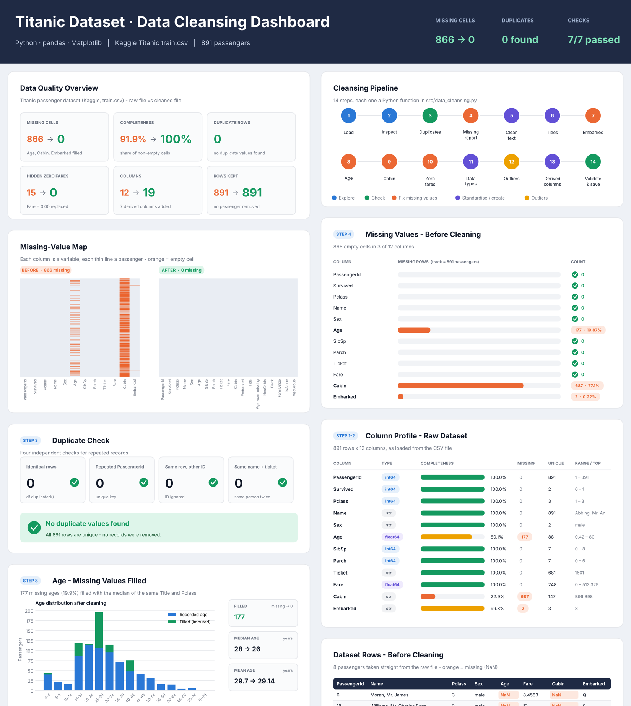
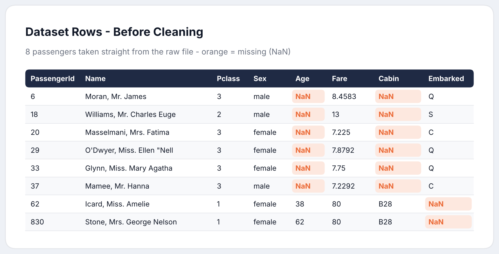
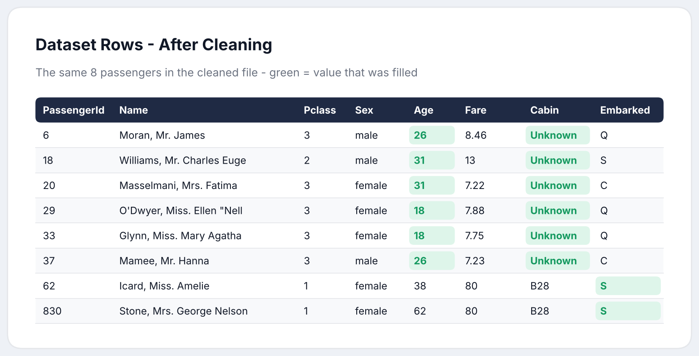

# Titanic Dataset – Data Cleansing with Python

A complete, reproducible data-cleansing project on the Kaggle **Titanic – Machine Learning from Disaster** dataset, written entirely in Python (pandas, Matplotlib, Streamlit), with a visual dashboard of every cleaning step.



## Dataset

| | |
|---|---|
| Name | Titanic – Machine Learning from Disaster (`train.csv`) |
| Source | Kaggle – <https://www.kaggle.com/competitions/titanic/data> |
| Download mirror used | <https://github.com/datasciencedojo/datasets/blob/master/titanic.csv> |
| Size | 891 rows × 12 columns |

## What the pipeline does

| # | Step | Result |
|---|------|--------|
| 1 | Load the CSV | 891 rows × 12 columns |
| 2 | Inspect data types and statistics | Age count 714/891, minimum Fare = 0 |
| 3 | Check for duplicates (full rows, IDs, rows ignoring ID) | **No duplicate values found** |
| 4 | Missing-value report | 866 missing cells: Age 177, Cabin 687, Embarked 2 |
| 5 | Clean text (whitespace, case) | 2 names fixed |
| 6 | Extract and standardise titles | Mr, Miss, Mrs, Master, Rare |
| 7 | Fill Embarked | Mode = `S` |
| 8 | Fill Age | Median of same Title + Pclass |
| 9 | Handle Cabin (77% empty) | `Unknown` + `Deck`, `HasCabin` |
| 10 | Hidden missing values (Fare = 0) | 15 fares → class median |
| 11 | Correct data types | `category`, ordered `Pclass`, `int8` |
| 12 | Outlier detection (IQR) | Flagged, checked and kept (genuine values) |
| 13 | Derived columns | `FamilySize`, `IsAlone`, `AgeGroup` |
| 14 | Automatic validation and save | 0 missing, 0 duplicates, 891 × 19 |

### Missing values – before vs after

| Before | After |
|---|---|
|  |  |

## Visual dashboard (Python)

| File | What it is |
|---|---|
| `dashboard/titanic_cleansing_dashboard.png` / `.pdf` | Full dashboard – 20 panels in one page |
| `images/dashboard/*.png` | Each panel on its own |
| `app.py` | Interactive Streamlit dashboard (11 sections, before/after switch, CSV download) |

Panels are drawn with Matplotlib in `src/visuals.py`, from metrics computed in `src/dashboard_data.py`.

## Project structure

```
titanic-data-cleansing/
├── data/
│   ├── raw/titanic_raw.csv           original Kaggle file
│   └── cleaned/titanic_cleaned.csv   output of the pipeline
├── src/
│   ├── data_cleansing.py             the cleaning pipeline
│   ├── dashboard_data.py             before / after metrics of every step
│   ├── visuals.py                    dashboard panels (Matplotlib)
│   ├── build_dashboard.py            full dashboard image + PDF
│   └── make_snapshots.py             code snapshots for the report
├── dashboard/                        finished dashboard (PNG, PDF)
├── images/                           dashboard panels, charts, code snapshots
├── app.py                            interactive Streamlit dashboard
├── report/Data_Cleansing_Report.docx full written report
├── requirements.txt
└── README.md
```

## How to run

```bash
git clone https://github.com/YOUR-USERNAME/titanic-data-cleansing.git
cd titanic-data-cleansing
pip install -r requirements.txt
python src/data_cleansing.py      # cleans the data -> data/cleaned/
python src/build_dashboard.py     # builds the dashboard -> dashboard/
streamlit run app.py              # interactive dashboard in the browser
```

## Report

The full formal report, with a code snapshot and a dashboard panel for every step, is in [`report/Data_Cleansing_Report.docx`](report/Data_Cleansing_Report.docx).
